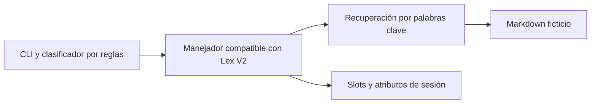
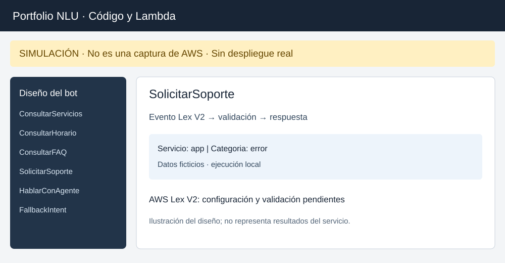
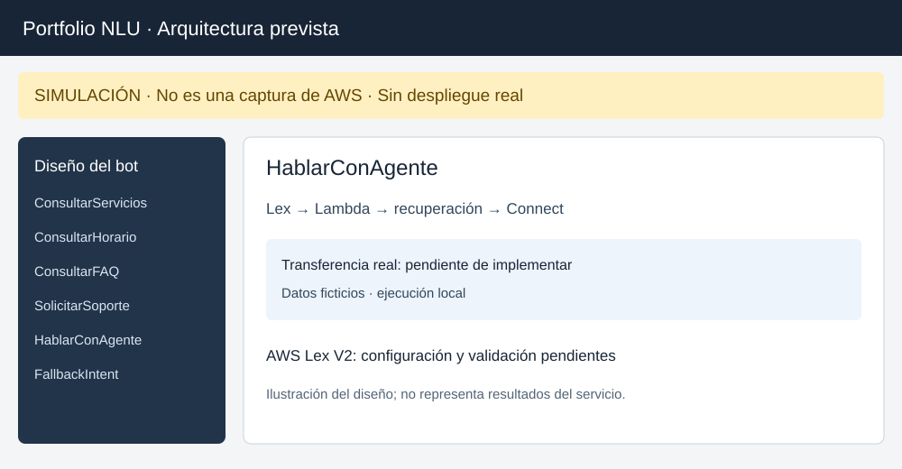

# Asistente NLU con contrato Amazon Lex V2

Proyecto personal de portfolio: atención al cliente en español con slots, fallback, recuperación documental y señal de derivación.

**Estado:** demo local. No se ha desplegado ni probado en Amazon Lex, Lambda o Connect. No requiere tarjeta, credenciales, paquetes externos ni llamadas de red.

## Ejecutar (Python 3.11 o superior)

```bash
python -m src.demo
python -m unittest discover -s tests -v
```

Prueba `qué horario tenéis`, `necesito soporte`, `web`, `error`, `quiero un agente` o `cuánto cuesta`. Escribe `salir` para terminar.

## Qué demuestra

- Contrato de eventos y respuestas de Lex V2, validación y elicitación de slots.
- Fallback con contador de sesión y señal de atención humana.
- Recuperación por palabras clave con fuente y abstención.
- Conversaciones con estado y pruebas automatizadas.

El clasificador local es una **simulación por reglas**, no el NLU de Amazon Lex. La respuesta documental es extractiva: **no hay embeddings, LLM ni RAG generativo implementado**. El nombre del repositorio refleja la arquitectura objetivo.

## Arquitectura ejecutable



Consulta [el diseño y la ruta a AWS](docs/architecture.md). Los datos de la empresa son ficticios. Ningún comando del proyecto crea recursos AWS. Esta versión no incluye workflows de GitHub Actions.

## Guía visual por carpeta

Las siguientes imágenes son **simulaciones conceptuales, no capturas de AWS**. No acreditan una integración desplegada.

### [Código y Lambda](src/README.md)



### [Base documental](data/README.md)


### [Evaluación local](tests/README.md)


### [Arquitectura prevista](docs/README.md)



