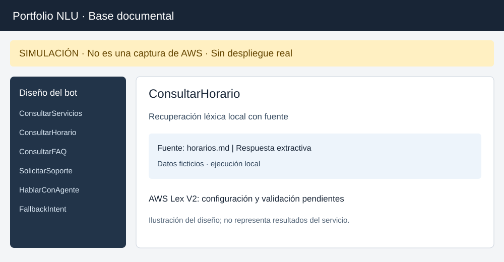

# Base documental

`knowledge/` contiene documentos Markdown de una empresa ficticia. Los títulos definen las palabras utilizadas en la recuperación. No contiene datos de clientes.

## Simulación visual

**Maqueta conceptual; no es una captura de Amazon Lex ni evidencia de despliegue.**

[Volver al README principal](../README.md)
