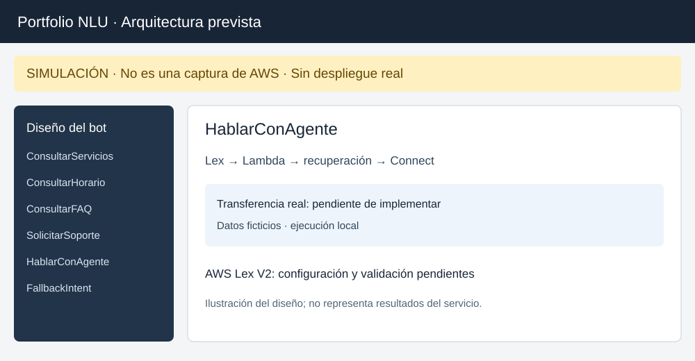

# Arquitectura prevista

`architecture.md` describe el estado real, la arquitectura objetivo, los pasos futuros y los costes. `previews/` contiene ilustraciones SVG propias, sin scripts ni recursos externos.

## Simulación visual

**Maqueta conceptual; no es una captura de Amazon Lex ni evidencia de despliegue.**

[Volver al README principal](../README.md)
