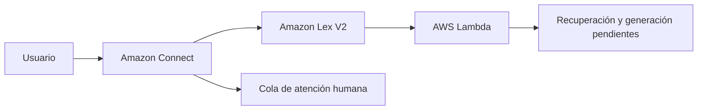

# Estado y siguientes pasos

| Componente | Estado |
|---|---|
| Recuperación léxica y respuestas extractivas | Implementado localmente |
| Clasificador NLU | Simulación por reglas; no es Lex |
| Manejador de eventos Lex V2 | Pruebas locales; no validado en AWS |
| RAG generativo con citas | Pendiente |
| Amazon Lex / Lambda desplegados | Pendiente |
| Amazon Connect y transferencia real | Pendiente |

## Arquitectura objetivo (no desplegada)

## Diseño NLU inicial

| Intención | Ejemplos |
|---|---|
| ConsultarHorario | ¿Cuándo abrís? / ¿Cuál es vuestro horario? |
| ConsultarServicios | ¿Qué servicios ofrecéis? / ¿Desarrolláis aplicaciones? |
| ConsultarFAQ | ¿Cuáles son las condiciones de cancelación? |
| SolicitarSoporte | Tengo un problema / No puedo acceder a la app |
| HablarConAgente | Quiero hablar con una persona / Pásame con un agente |
| AMAZON.FallbackIntent | Integrada en Lex; nombre de intención del proyecto: FallbackIntent |

Slots personalizados: Servicio (web, app), Categoria (acceso, error). El diálogo solicita los valores ausentes o inválidos. El contador de fallback se reinicia con una intención reconocida. Una nueva sesión empieza sin contador.

## Ruta de implementación con autorización y presupuesto

1. Crear Lex V2 en una región y locale español compatibles con Connect; ampliar frases de entrenamiento y reservar frases distintas para evaluación. Configurar fallback integrado, slots y alias. Verificar disponibilidad en las consolas oficiales.
2. Empaquetar `src/` y `data/` juntos en la raíz del ZIP de Lambda; handler `src.lambda_handler.lambda_handler`. Configurar rol mínimo, permiso de invocación para Lex y asociación de Lambda al alias de idioma. Habilitar dialog hook para validación y fulfillment hook para cumplimiento, probando ambos. El código local responde directamente; no delega validación a Lex.
3. Añadir generación con modelo y recuperación semántica si procede. Comparar Bedrock Knowledge Bases con recuperación local; revisar costes de inferencia, embeddings, almacenamiento, ingestión y almacén vectorial. Añadir límites de contexto, citas verificadas y defensas frente a instrucciones dentro de documentos. No confundir esta recuperación léxica con RAG generativo.
4. Asociar bot y alias a Connect y crear un flujo de chat. El flujo debe leer `handoffRequested`, transferir a una cola y manejar errores y falta de agentes. La señal de Lambda no ejecuta una transferencia. Verificar compatibilidad regional y límites de latencia antes de integrar generación.
5. Exportar la configuración real de Lex y documentar importación, versiones y alias. Mantener separadas las métricas locales y las de AWS. No añadir infraestructura declarativa hasta haber validado el diseño.

## Costes y limpieza

Esta demo solo ejecuta Python y lee archivos. No llama a AWS ni crea recursos. No requiere configurar credenciales.

El despliegue futuro puede generar costes por Lex, Lambda, CloudWatch, almacenamiento, Bedrock y Connect. Revisar precios oficiales: https://aws.amazon.com/lex/pricing/ , https://aws.amazon.com/bedrock/pricing/ y https://aws.amazon.com/connect/pricing/ . No asumir capa gratuita. Un presupuesto con alertas no garantiza gasto cero.

No ejecutar despliegues sin autorización. Si se despliega, inventariar y borrar bots y alias, funciones, logs, fuentes de conocimiento, índices, buckets y recursos de Connect; liberar números contratados. Comprobar facturación y recursos residuales. Esta versión local no necesita limpieza en AWS.

## Evaluación y límites

Las pruebas unitarias verifican el contrato local, slots, fallback, señales y recuperación. No miden precisión de Lex ni latencia en AWS. Para evaluar el NLU real, reservar frases nunca usadas en entrenamiento y registrar matriz de confusión, exactitud de slots y tasa de fallback. Para RAG, registrar fuentes recuperadas, exactitud de respuestas y abstenciones. Para Connect, registrar transferencias efectivas y errores. No se han obtenido métricas de esos servicios.
