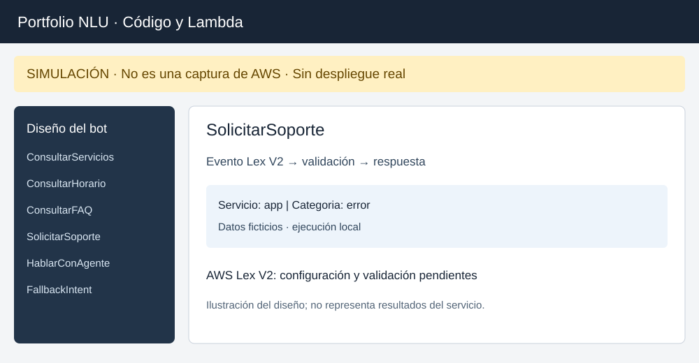

# Código y Lambda

`demo.py`: CLI y reconocimiento simulado por reglas. `lambda_handler.py`: procesamiento local de eventos Lex V2. `rag.py`: recuperación léxica y respuesta extractiva, sin LLM.

## Simulación visual

**Maqueta conceptual; no es una captura de Amazon Lex ni evidencia de despliegue.**

[Volver al README principal](../README.md)
