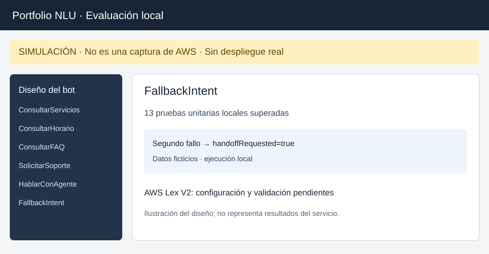

# Evaluación local

Ejecuta `python -m unittest discover -s tests -v` desde la raíz. Las 13 pruebas comprueban el comportamiento local; no evalúan el servicio Amazon Lex.

## Simulación visual

**Maqueta conceptual; no es una captura de Amazon Lex ni evidencia de despliegue.**

[Volver al README principal](../README.md)
